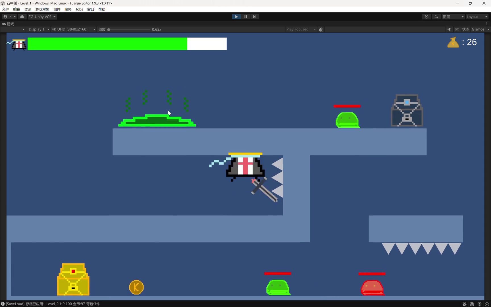

# 石中剑 Stone Sword



一款基于**团结引擎**（Tuanjie Engine，Unity 2022.3 中国版）从零开发的 **2D 横版动作游戏 Demo**。包含战斗、背包、商店、传送门、存档、死亡等完整系统，覆盖「主菜单 → 关卡1 → 关卡2 → 通关」全流程。


---

## 🎬 演示视频

<video src="Assets/Demo/DemoVideo.mp4" controls preload="metadata" width="100%"></video>

▶ **[点击观看演示视频（2 分 19 秒）](Assets/Demo/DemoVideo.mp4)**

> 2 分 19 秒真实游玩过程：主菜单 → 战斗 → 商店 → 背包 → 存档 → 死亡 → 传送门 → 通关全流程。

## 🎮 玩法流程

```
主菜单 MainMenu → 关卡1 Level_1 → 关卡2 Level_2 → 通关 End
```

- 用近战挥剑击败史莱姆（Slime）与幽灵（Ghost）等敌人
- 开宝箱、捡金币，找Shop购买武器与治疗药水
- 穿过传送门进入下一关（自动存档），可以手动按 E 存档
- 血量归零弹出死亡界面 → 返回主菜单 → 读档后从上次位置继续

## 🕹️ 操作说明

| 按键 | 作用 |
|------|------|
| A / D | 左右移动 |
| J | 攻击 |
| F | 交互（NPC / 宝箱 / 传送门） |
| I | 打开背包 |
| Q | 使用当前选中物品 |
| X | 销毁当前选中物品 |
| E | 手动存档 |
| ESC | 暂停菜单 |

## 🧠 架构设计亮点（C# / Unity）

### 1. 接口 —— 交互系统与受击系统解耦

```csharp
public interface IInteractable
{
    void Interact();
    string GetTipText();
}
```

NPC、宝箱、金币、传送门等**互不相同的物体统一实现 `IInteractable` 接口**。玩家的交互逻辑（`PlayerInteract`）只依赖接口，不关心具体物体是谁——**新增一种可交互物体时，无需改动任何玩家代码**。

同理，`IDamagable` 接口统一了"可受伤"的概念，`PlayerHealth` 与所有 `EnemyHealth` 共用同一套伤害结算入口（`DamageInfo` 传参），攻击者与受伤者完全解耦。

### 2. 继承 + 多态 —— 敌人与 Buff 的模板化设计

```csharp
public abstract class BuffBase          // 抽象基类：定义"一场 Buff 的生命周期"
{
    public abstract void OnApply(...);
    public abstract void OnUpdate(...);
    public abstract void OnRemove(...);
    public virtual void TickTimer(float deltaTime) { ... }
}
```

- `PoisonBuff`（中毒持续掉血）、`SlowDownBuff`（减速）继承自 `BuffBase`，**各自覆盖生命周期方法**，实现完全不同的效果
- 管理器用一个 `List<BuffBase>` **以多态方式统一驱动**所有 Buff 的更新与销毁——新增一种 Buff 只需新写一个子类
- 敌人系统同样采用**模板方法模式**：`EnemyBaseAttack` / `EnemyBaseMove` 抽象基类规定移动/攻击框架，史莱姆与幽灵通过覆盖细节实现差异

### 3. 数据驱动 —— ScriptableObject 配置与逻辑分离

```csharp
[CreateAssetMenu(...)]
public class SwordSO : ScriptableObject   // 武器数据资源
{
    public string swordName;
    public int price;
    public int swordAttackDamage;
    public float swordCritRate;
    public float swordCritDamage;
    ...
}
```


武器、角色属性等用 **ScriptableObject 做成可配置资源**（直接在 Inspector 里调数值、换贴图），代码与数值解耦——调平衡不需要改代码。

### 4. 单例 + 跨场景生命周期管理

- **存档系统（SaveLoadManager）**：单例 + 两层存储模型——`PlayerPrefs` 负责持久化到硬盘，内存中的 `pendingData` 充当"跨场景快递员"在场景切换瞬间传递数据；区分"手动档 / 自动档"，恢复逻辑放在 `Start` 而非 `Awake`，精准控制初始化顺序
- **暂停系统（PauseManager）**：用**引用计数**（`RequestPause` / `ReleasePause`）管理 `Time.timeScale`，多个 UI（商店/暂停/死亡）叠加出现时不会互相"取消暂停"
- 场景物体（金币、宝箱）用 **「场景名+坐标」字符串作为唯一 ID** 记录状态，实现存档一致性

### 5. 程序化音效 —— 零音频资源

攻击、金币、受伤、跳跃等音效**全部在运行时用代码合成**（白噪声滤波 / 正弦扫频生成 `AudioClip`），不依赖任何外部音频文件——小体量也能有完整听觉反馈。

### 6. 手绘美术 + Animator 动画系统

玩家与所有敌人的**像素图像均在 Piskel 中逐帧手工绘制**，再切成动画帧序列导入引擎，通过 **Animator 状态机**（4 个 Controller、10 个动画片段）驱动移动 / 攻击 / 坐下 / 受击 / 挥剑等动作切换。

### 7. 协程实现幽灵淡入淡出

幽灵是"隐形怪"设计：巡逻时几乎完全透明，一旦玩家进入视野范围便**淡入现身**，离开后淡出隐藏。用协程在 `fadeDuration` 内对 `SpriteRenderer` 的 alpha 做 `Mathf.Lerp` 插值，并配合 `StopCoroutine` 打断上一次渐变，避免连续触发时透明度叠加错乱：

```csharp
IEnumerator FadeCoroutine(float targetAlpha, bool showHud)
{
    Color startColor = sr.color;
    float timer = 0f;
    while (timer < fadeDuration)
    {
        timer += Time.deltaTime;
        float newA = Mathf.Lerp(startColor.a, targetAlpha, timer / fadeDuration);
        color.a = newA;
        sr.color = color;          // 逐帧写入透明度
        yield return null;
    }
    sr.color = color;              // 结束后校正到目标值
}
```

## 🛠️ 技术栈

- 引擎：团结引擎 Tuanjie 1.9.3（对应 Unity 2022.3.62t11）
- 语言：C#
- 场景格式：`.scene`（团结引擎格式）
- 版本管理：Git（SourceTree）

## 🚀 如何运行

1. 使用团结引擎（2022.3.62t11+）打开项目
2. 打开场景 `Assets/Scenes/MainMenu.scene`
3. 点击 Play 运行；或通过 **File → Build Settings** 打包成可执行文件

## 设计过程AI协助

此demo的全部设计理念、核心制作过程和修改调试由本人完成，同时使用WorkBuddy并接入DeepSeek-V4-Flash模型进行协助工作，包括代码纠错、结构优化等方面。

## 📁 目录结构

```
Assets/
├── Player/      玩家与 UI Prefab（PlayerBody / PlayerCanvas / DeathCanvas）
├── Enemy/       敌人：史莱姆 & 幽灵（检测 / 移动 / 攻击 / 血量）
├── Chest/       宝箱（普通 / 黄金 / 诅咒）
├── Coin/        地面金币与金币管理
├── Shop/        NPC 商店、商店 UI 与槽位
├── Sword/       武器 ScriptableObject 与地面武器
├── Potion/      药水物品
├── Buff/        临时状态（中毒 / 减速）
├── Trap/        陷阱（尖刺 / 沼泽）
├── Scenes/      主菜单、关卡1、关卡2、通关
├── Pause/       引用计数暂停管理器
├── Sound/       程序化音效管理器
└── Others/      存档/读档、数据类、死亡与通关控制器
```

---
*自学 Unity / C# 期间完成的独立游戏 Demo。*
